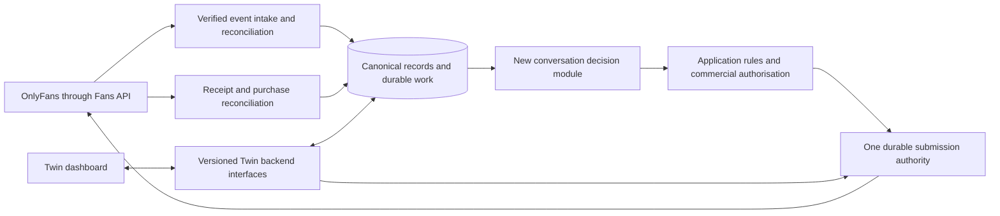

# Twin engine architecture and Terra handoff

Prepared 7 November 2026, Australia/Brisbane. The inspection and architecture task made no application changes. Handoff updated after Jesse clarified that the next chat should begin building: isolated implementation and testing on Work Server may proceed; live actions and spending retain the separate approval points below.

## 1. Plain English overview

Keep the Twin dashboard and its account, inbox, operator-control, vault and reporting interfaces. Build a new, separately versioned conversation decision module and a Fans API transport adapter. Preserve the existing financial evidence, media approvals, delivery records and account identities. Retain one application-controlled submission authority for automated and human messages.

A fan message should enter a durable inbox, be assigned to the verified creator and fan, update the conversation state, and produce a proposed reply using the latest relevant history and approved facts. Application checks decide whether any proposed commercial action is authorised. The submission authority records and checks each outgoing action before Fans API receives it. Subsequent provider observations update purchase, delivery and access records separately. The dashboard displays those records and any uncertainty.

This structure is supported by the inspected code: the dashboard already uses versioned backend interfaces, while the backend already has durable intents, account bindings and financial evidence. However, the shared delivery authority still calls old Moxy rules. Putting a new writer in another process would leave those rules in control unless those dependencies are explicitly removed from the new path.

**Recommendation: retain the dashboard, begin isolated implementation, and qualify Fans API as a candidate adapter. The complete product is not yet qualified for live rollout.** The full requested behaviour is not verified as feasible. Critical gaps are platform permission, the exact runtime model/provider contract, historical purchase-to-media linkage, current production identity, and combined worker/vault compatibility. A transport change cannot repair these by itself. Build components whose contracts can be established from the evidence; keep unresolved dependencies explicit and stop the affected work rather than repeating the whole planning exercise.

The detailed engineering proposal below covers non-graphic conversation, commercial state, transport, recovery and migration. It does not provide an explicit sexual-content generator or instructions for bypassing provider safeguards. The supplied requirements remain unchanged; this narrower engineering scope must not be represented as satisfying every clause of rules 2 and 12.

## 2. What is verified and what is missing

### Evidence labels and inspection boundary

**V** means independently inspected source or stored evidence during this task. **D** means a capability or constraint documented by the vendor, without a live account test. **H** means a historical report whose claim was not reproduced here. **P** means a proposed design. **U** means unresolved.

Read-only SSH verified hostname `ubuntu-s-4vcpu-8gb-syd1`. Relevant paths were verified under `/srv/projects`. `/srv/projects/PROJECTS.json` was not present at the inspected path. The first sandboxed SSH attempt could not resolve the alias; approved host SSH succeeded. No application imports, builds, tests, installs, provider requests, production queries, service changes, messages or purchases were performed. Existing saved production evidence was read locally. Only planning documents were written.

No application environment file or credential value was printed. Environment-variable names in source establish configuration mechanisms, not their live values. Source inspection does not establish current deployment or access.

### Exact source snapshots

| Evidence | Location, branch and commit | What this establishes |
|---|---|---|
| V1 | Work Server `/srv/projects/moxy-worker-release-review-20261106/source`, detached HEAD `fa7f1387267b43fafc1b34a8c44690c4ac579c2d`; origin is the local `/srv/projects/onlyfans-vault-repair-20261106` repository | Actual worker candidate inspected. Common baseline is `e26c7412eb3142da2be4552411dd461807da7ec0`. Candidate source belongs to the Twin OnlyFans backend family; this checkout is not evidence that fa7f138 is deployed or published remotely. Tracked and untracked status was clean. |
| V2 | `/srv/projects/moxy-dashboard`, branch `codex/moxy-controls-20261102`, HEAD `a39e34a524b74bdf3bb2e5571453e56401796864` | Actual dashboard routes and parsers inspected. No origin remote was configured here. Historical repository inventory associates this family with `twinagency/twin-dashboard`; current remote HEAD and deployed parity remain unverified. Tracked status clean; existing untracked `artifacts/` must be preserved. |
| V3 | `/srv/projects/onlyfans-vault-repair-20261106`, branch `codex/vault-recent-window-20261106`, HEAD `91be062064b3071fea1a11509ed90d81ecb0075e`, origin `https://github.com/twinagency/twin-onlyfans-backend.git` | Actual vault candidate and diff inspected. Tracked status clean; existing untracked evidence, scripts, delivery directories and archives must be preserved. |
| V4 | `/srv/projects/moxy-engine`, branch `codex/moxy-replacement-20261102`, HEAD `54020a7193b79521be3ba284ea8582b2b94d3537`, same backend origin | Metadata inspected as a recovery-source location. Not selected as the new engine baseline. |
| V5 | Local `twin-dashboard`, `main`, `fb6b345692a735d131b875e7b69ce8f955ba9a03`, origin `ronan-com/twin-dashboard` | Older local checkout metadata only; not the proposed dashboard baseline. |
| V6 | Local `twin-sexbot`, `codex/onlyfans-integration`, `7b0036bf4d1a58413c57d19434fa4bcad3a1c4f4`; local `bot`, `codex/telegram-fastt`, `f414f32da07f32f1108c4ed7bd34139e547d59ef` | Both contain pre-existing tracked changes. They were not modified and must not be reset or used as clean baselines. |

The older local history-memory, ledger-recovery and proactive-selling worktrees were identified at `028acda1c246f807439c441406c392de83a62c12`, `4b4a7f3dcd21c68815cdb83b77c5e861e1fa256b` and `5f292e230bfc27ad1e563e50196a5413b3d049bd`. Their metadata is historical context, not the intended behaviour.

**Exact starting points for the isolated development checkout:** backend fa7f138 and dashboard a39e34a above, with vault 91be062 treated as a separate integration input. There is no verified single combined starting commit. Stage 0 must verify this tuple or document why newer source is needed, then record the actual integrated commit. Do not pretend these snapshots are the latest production sources.

### The one governing specification

`FINAL-TWELVE-RULE-SPECIFICATION.txt` in this directory contains the supplied title, all twelve rules, the amendments to rules 2 and 12, and the final goal, extracted without changing their wording. It excludes the surrounding planning request and stray chat timestamp.

- Original attachment SHA-256: `8486b8f946ae14f570420137ae1ceaa14d077c22545f5200bb5215b62434b507`.
- Extracted specification SHA-256: `5364224b0fd63d36ae53c479e0691a48e89e929db621a02bc1af3cd3f044e155`.

Old writer prompts, examples, sales ladders, creator projections and prior plans are **REFERENCE ONLY**. They may explain schemas or incidents; they do not amend this specification. Existing creator-specific boundaries need explicit review against the new specification rather than automatic copying. An unresolved provider conflict is a blocker, not permission to quietly weaken the specification.

### Dashboard compatibility

V2 contains a usable adapter boundary, but full feature parity is unproven.

| Surface | Exact inspected interfaces | Compatibility obligation |
|---|---|---|
| Accounts, inbox, operations | `app/api/onlyfans/accounts/route.ts`; account conversation and workspace routes; `lib/onlyfans/backend.ts`, `reads.ts`; `lib/onlyfans-preview/types.ts` | Preserve `of-preview.v2`, explicit unavailable/error states, stable account IDs, pagination, authorisation and agency scope. |
| Takeover and manual messages | `app/api/onlyfans-controls/accounts/[accountId]/conversations/[conversationId]/route.ts`; `lib/onlyfans/controls-backend.ts`, `controls.ts` | Preserve `of-controls.v1`, expected revision, actor, command key and unconfirmed outcomes. The current browser route validates numeric provider message IDs; strings from Fans API need checked conversion or a versioned contract change. |
| Creator configuration | `app/api/onlyfans-configuration/accounts/[accountId]/moxy/route.ts`; `lib/onlyfans/moxy-backend.ts`, `moxy.ts` | Preserve saved revisions, management permissions and uncertain-save behaviour. Current schema is `of-configuration.v3`; new engine settings require an explicit compatible projection or new version, not silently reinterpreting old Moxy settings. |
| Vault, products and media | Existing `onlyfans-content` routes; `lib/onlyfans/content*.ts`, `vault*.ts`, `manual-media.ts` | Preserve approvals, edits, previews, streaming, range handling, upload status, folder semantics and inaccessible-media states. Endpoint availability alone does not prove parity. |
| Memory and financial sidebar | `lib/onlyfans/launch/memory/*`, `fan-financials.ts`, `chat-content-history.ts`; backend memory projection | Sidebar and reply builder must consume the same versioned facts and uncertainty. A successful background job is not proof of useful visible memory. |
| Shared dashboard functions | Authentication, creator identity and non-OnlyFans routes remain in the shared dashboard | Regression-test existing Telegram and other creator views when shared code changes; do not alter their runtime engines. |

`lib/onlyfans/backend-transport.ts:11` uses one `ONLYFANS_API_BASE_URL` with distinct API, CONTROL, CONFIGURATION, CAMPAIGN, CONTENT and CONNECTION credentials, rejecting equal purpose tokens. The transport attempts writes once with an 8-second default timeout. These are internal Twin contracts; pointing that base URL directly at Fans API would not preserve them.

Backend route owners inspected: `service/onlyfans_app.py`, `onlyfans_read/api.py`, `onlyfans_commands/api.py`, `onlyfans_commands/configuration_api.py`. Existing route families include `/onlyfans/api/v1`, `/onlyfans/control/v1` and `/onlyfans/configuration/v1`.

### Existing state and concrete defects

**V7 — saved purchase evidence, not a fresh production query.** Local `output/onlyfans-sync-audit-20261106/purchase-links-result.json`, command `d2414f53-8b7a-497a-9f87-1342b52ca634`, started 6 November 2026 08:13:47 UTC, or 18:13:47 Brisbane. Its companion `purchase-links-readonly.py` uses a repeatable-read, read-only transaction and scopes transaction counts to accounts in `of_runtime`. The result contains 277,631 cleared `ppv_message` rows with zero non-null `message_id` links. Its paid-message and purchased-vault-send aggregate queries returned no rows. This demonstrates a serious linkage/coverage problem in that snapshot. It does not demonstrate that no fan purchased or accessed content, nor that every historical row belongs to the present account binding.

**V8 — saved uncertain-send evidence.** `output/moxy-readonly-audit-20261105/EVIDENCE.json`, captured 5 November 2026 03:56:22 UTC, contains thirteen accepted intents and one unknown intent for the audited conversation. Intent `2e236f36-7765-4cc9-a51e-999ba0d0196e` is `unknown/ambiguous_transport` with no provider message ID. The companion audit identifies subsequently imported similar outgoing text as a reconciliation candidate, not a receipt. Preserve this distinction during migration; current resolution is unknown.

**V9 — model and application compatibility.** The stored model-call rows in V8 identify `openrouter/deepseek-v4.1-flash` through `openrouter`. This is a historical runtime choice, not a newly approved model or evidence of the underlying inference host. Current source uses `AccountAiConfig`, `service/llm_models.py`, `llm_providers.py` and `onlyfans_runtime/provider_model.py`; an explicit account-bound model is resolved through the registry. No actual-model call was made here.

**H1 — observed conversation failures.** The 5 November audit reports repeated openers, incorrect scope of restrictions, old model replies treated as authority, dropped follow-through, ambiguous offer references and an unknown send blocking a later correction. Use it to derive non-graphic regression cases. Its old policy is not the new design. Those model outcomes have not been rerun against fa7f138 here.

**H2 — candidate qualification gap.** `/srv/projects/moxy-worker-release-review-20261106/provider-handoff/REVIEW.txt` reports 547 non-database passes and a focused database run with 28 passes and one failing human-description compatibility case. It also reports no combined final-image qualification. These are prior test results, not tests performed in this task. The review identifies `service/tests/test_moxy_media_descriptions_pg.py:75` and the editor/description-version reader as the failing interaction.

**V10 — current source coupling.** `onlyfans_runtime/text_delivery.py:210,399,480,645,795` calls old Moxy delivery/routing/runtime functions; it also calls native-sales and engagement policy. `moxy_replacement/routing.py` fences numerous old automation job kinds, while manual sends have specific exceptions. `of_delivery_policy.transport_kind` accepts only `synthetic` and `native`. Fans API therefore requires a deliberate adapter capability and schema design; relabelling it as native would hide different guarantees.

**V11 — vault improvements to preserve.** V3's `service/vault_import_policy.py` defines 1,500 photos, 700 videos, 7,200-second head checks and 86,400-second reconciliation. `ONLYFANS_VAULT_RECENT_WINDOW_ENABLED` gates it. The candidate adds migration `20261106_0100_vault_recent_window.py` / schema 0112. This limits automatic import/analysis, not historical ownership or approved-product availability. V1 expects schema 0111. A source merge reported as clean in H2 is not proof that all images accept 0112.

### Fans API documented capability and limitations

These sources were read on 7 November 2026. They describe the vendor's API, not an official OnlyFans API or a completed integration.

| Area | Documented fact | Decision or missing proof |
|---|---|---|
| Provider identity | Fans API is the renamed OnlyFans API service and identifies itself as independent and unofficial. | Do not mix documentation for similarly named `.io` or `.app` services. [Introduction](https://docs.onlyfansapi.com/introduction), [compliance](https://docs.onlyfansapi.com/compliance). |
| Text and paid cards | `POST /api/{account}/chats/{chat_id}/messages` documents text, media IDs, previews, locked text and USD pricing of zero or $3–$200. | Qualify actual account permissions, exact payloads and returned identities. Existing media shapes may not support every provider feature. [Send message](https://docs.onlyfansapi.com/api-reference/chat-messages/send-message). |
| Send uncertainty | The recovery guide distinguishes `not_sent` and `unknown`, bounds idempotency retention, and explicitly disclaims unconditional exactly-once execution. | Persist immutable request identity; unknown must remain unresolved. Do not infer success or failure from HTTP status alone. The endpoint introduction's broad 5xx retry wording conflicts with the more specific recovery guidance; follow the conservative outcome rules and obtain provider clarification. [Idempotency](https://docs.onlyfansapi.com/introduction/essentials/idempotency). |
| Events and identity | Received/sent messages and PPV unlocks are documented. Unlocks identify message and chat; some `user_id` fields identify the creator. An account disconnected and newly connected gets a new `acct_` ID. | Map provider connection IDs to stable OnlyFans creator identity and binding epochs. Do not infer historical purchase coverage from new events. [Events](https://docs.onlyfansapi.com/webhooks/available-events). |
| Webhook reliability | Signature uses HMAC SHA-256 over request content. Delivery requires timely acknowledgement; three total attempts are documented, then abandonment. Retry identity is provided for durable event types. | Persist before acknowledging, deduplicate, and reconcile gaps. No assumed endless replay or ordering. [Protection](https://docs.onlyfansapi.com/webhooks/protecting-your-webhooks), [delivery](https://docs.onlyfansapi.com/webhooks/delivery-and-retries). |
| History and read state | History is paginated; short pages may still have a next page. `seenByFan` can be true, false or unavailable. | Follow continuation to exhaustion for the specified interval. Seen message, paid unlock and playable media are distinct facts. [History](https://docs.onlyfansapi.com/api-reference/chat-messages/list-chat-messages). |
| Vault | Media listing supports types, ordering, offsets and text query. | Test current identity, retrieval, readiness and deleted/replaced content. Provider text search is not proof of semantic catalogue matching. [Vault](https://docs.onlyfansapi.com/api-reference/media-vault/list-vault-media). |
| Finance | Transaction and chargeback listing endpoints exist. Transactions default to a recent start date. | Explicit historical intervals and full pagination are required. Exact old message linkage, refunds, chargeback updates and absence proofs remain unqualified. [Transactions](https://docs.onlyfansapi.com/api-reference/transactions/list-transactions), [chargebacks](https://docs.onlyfansapi.com/api-reference/chargebacks/list-chargebacks). |
| Freshness | Endpoints can be live, enriched or computed from stored data. | Store field-level provenance and coverage; a successful response is not universal freshness. [Data sources](https://docs.onlyfansapi.com/introduction/essentials/endpoint-data-sources). |
| Limits | Published per-minute limits are shared by team across keys/accounts; cached reads also count. The current guide removes daily limits. | Use a team-wide budget plus fair account queues; do not use stale example daily limits as the real contract. Subscription and account-specific upstream constraints remain unknown. [Limits](https://docs.onlyfansapi.com/introduction/essentials/rate-limits). |

The vendor FAQ retrieval exposed headings without their answers. The prior handoff says there is no sandbox, but this task did not independently recover that answer. **Assume calls are real and billable unless the provider proves an isolated sandbox.** Likewise, no webhook replay window, SLA, read side-effect guarantee or ability to cancel a submitted send was independently established. No paid/account API was invoked to discover these.

### Rules 2 and 12 compatibility result

**Not verified; no compatible runtime writer is approved.**

The historical OpenRouter route cannot be treated as permission for every requested use: OpenRouter requires compliance with applicable model/provider terms. DeepSeek's direct service terms explicitly restrict sexually explicit chatbots, and its Open Platform terms incorporate those rules. Whether the historical routed model used a different host and governing licence is unknown; do not assume either that the direct-service contract applies identically to every hosted model or that routing removes restrictions. [OpenRouter terms](https://openrouter.ai/terms), [DeepSeek terms](https://cdn.deepseek.com/policies/en-US/deepseek-terms-of-use.html), [Open Platform terms](https://cdn.deepseek.com/policies/en-US/deepseek-open-platform-terms-of-service.html).

OpenAI's current published Model Spec says GPT should not generate erotica outside the specified contextual exceptions. It does not establish support for this project's requested explicit erotic conversation. Terra 6.1 is the proposed coding agent; choosing it as builder does not select or qualify the application's writer. [OpenAI Model Spec, 29 October 2026](https://model-spec.openai.com/2026-10-29.html#dont-respond-with-erotica-or-gore).

Application compliance is also unproven. The inspected source retains creator-rule projections, validators, shared operator-case scans and correction passes. Historical evidence shows that a permissive conversation flag did not prevent an incorrect restriction in the eventual response. No application audit or regression run in this task establishes rules 2 and 12 end to end. I cannot provide the explicit-generation implementation or a safeguard-bypass strategy. Preserve the requirement as unresolved, rather than claiming compliance with a non-graphic substitute.

### Decisions and evidence required before dependent work

| Gate | Exact missing item | How to close it |
|---|---|---|
| G1 Platform permission | Current OnlyFans Terms, Acceptable Use Policy and applicable AI/chat rules; creator written management authority | Obtain the current official text and, if needed, written platform clarification. Direct web retrieval failed; the browser site-safety policy blocked OnlyFans. Fans API marketing cannot resolve this. Do not assume human review alone makes an otherwise prohibited workflow permitted. |
| G2 Runtime scope and model | Exact model ID/revision, router and inference host, applicable terms, privacy/retention settings, account access, full required behaviour | Produce a compatibility decision for a lawful, supported scope. Reject incompatible combinations; do not try prompt tricks or provider switching to evade restrictions. No complete-build readiness while the requested behaviour remains incompatible or unverified. |
| G3 Source and runtime baseline | Current dashboard/API/reader/sender images and hashes, schema, flags, scopes, queues, external writers | Read-only inventory with timestamp and allowlisted config fields; compare to V1–V3. Identify newer uncommitted work before choosing a branch. |
| G4 Purchase and delivery migration | Current transaction/message/media links, refunds, binding history, all unresolved submissions and accepted-but-unprojected receipts | Read-only scoped export and coverage manifest; review ambiguous cases individually. Historical counts cannot be converted into ownership guesses. |
| G5 Fans API access | Team, connected creator mapping, plan, balance, entitlement, exact upstream/error semantics | User supplies console confirmation without exposing keys; later approve bounded provider qualification. Any metered read requires the later budget. |
| G6 Business operations | Per-creator facts/boundaries, catalogue approvals, discount/overlap rules, offer validity, cancellation/remedy authority, staff coverage, retention, load | Named owners approve a versioned operational decision sheet. Missing values block only dependent actions. |
| G7 Implementation direction | Jesse subsequently clarified that the next chat should build | Proceed with isolated implementation and testing on Work Server. Do not ask again merely to start coding. This does not authorise live deployment, sending, spending, production changes, unsupported content generation or resumption of paused two-creator work. |

## 3. Detailed architecture

All components in this section are proposals unless an existing owner is explicitly named. Start with a modular backend and PostgreSQL durable work. A new message broker, vector database, independent sales service or second financial ledger is not justified by the evidence.

### Authority and interfaces

| Component | Sole responsibility and authority | Communication |
|---|---|---|
| Twin dashboard | Present state; collect authenticated operator commands. It does not decide purchase truth or directly call Fans API. | Existing versioned server routes, capability-scoped credentials and expected-revision commands. |
| Backend facade | Verify staff/agency/creator access, validate contracts and project canonical records. | Keeps current dashboard response contracts; version changes explicitly when new status/IDs cannot be represented. |
| Creator configuration | Creator/delegate-approved boundaries, role disclosure, factual claims and style examples, each with scope, version and approval | Engine receives only relevant approved projections. Examples never override facts, catalogue or provider constraints. |
| Conversation state machine | Request references, durable corrections, sales pause, pending actions, responsibility and dependency ordering | Reads a transactionally coherent snapshot; stores a proposal against its revision. It cannot submit externally. |
| Writing model | Produce non-graphic draft wording and proposed references within the approved scope | No credentials, arbitrary destinations, direct charge or send capability. Output is untrusted and validated. No silent model/provider fallback. |
| Fan history and memory | Canonical messages and provenance-backed observations for one creator/fan/binding context | Existing `messages`, `fans`, profile and correction records; one projection consumed by engine and sidebar. |
| Catalogue and price authority | Approved product versions, actual media mapping, availability, currency, prices, permitted discounts and bundle contents | Model can request/select an eligible reference; server resolves terms from a frozen approved version. |
| Purchase and access projection | Verified financial observations and exact entitlements | Existing `transactions`, `of_ledger_evidence`, `of_commerce_evidence`, message and vault ownership projections; preserve raw evidence. A purchase without an item link remains a purchase with unresolved entitlement. |
| Submission authority | Final destination, revision, authorisation, ownership and dependency checks; immutable intent; one transport submission decision | Extend/extract existing `OfTextIntent`/`TextAuthority` mechanisms. All manual, automated and scheduled paths converge here. No parallel new outbox for the same action. |
| Fans API adapter | Map requests, events and evidence into typed internal forms; preserve provider IDs, errors, timestamps and provenance | Server-side HTTP only. Internal `Accepted`, `NotAccepted`, `Unknown` and capability/freshness results; cannot decide commercial permission. |
| Reconciliation workers | Catch missed events, materialise accepted receipts, resolve unknown outcomes from adequate evidence, update finance/access | Durable leased work with unique logical keys. A lease expiry schedules investigation; it does not authorise a resend. |
| PostgreSQL | Atomic action creation, unique constraints, account isolation, revisions, durable jobs and audit events | Per-conversation serialisation, bounded transactions, indexed due-work scans. No network call inside a DB transaction. |
| Monitoring and operator queue | Detect failures and track accepted human responsibility | Privacy-safe metrics plus restricted evidence links. Escalation has owner, status, next step and due time. |

Identity keys are `(tenant_id, stable_onlyfans_creator_id, fan_id)` plus the current binding/connection epoch. Preserve existing internal `of-...` account IDs. Store `acct_...` as connection identifiers, never as permanent creator identity. Treat external IDs as opaque strings. Only documented numeric IDs may be normalised to decimal strings or database integers, with lossless range checks; never cast a prefixed connection ID. Currency amounts remain integer minor units internally.

### State that must be explicit

- **Request:** open, waiting for fan, waiting for provider, ready, in progress, handed-over-pending, handed-over-accepted, completed, declined or cancelled. Store owner, item/offer/action references, source message, next step, due time and waiting reason.
- **Sales permission:** open or paused, reason/source, current explicit reopening scope and revision. Ordinary chat, elapsed time, a complaint or factual price question does not reopen pitching. An existing paid obligation survives a sales pause.
- **Offer:** draft, available, expired, withdrawn or superseded, with immutable terms and media-version snapshot. Agreement to receive a locked card is not payment.
- **Submission:** prepared, queued, dispatching, accepted, conclusively not accepted, unknown or cancelled-before-submission. Accepted provider identity and local transcript projection are separate fields.
- **Purchase:** observed, verified, unmatched, disputed, refund-pending, refunded or chargeback, with exact evidence and affected entitlement. Do not force provider statuses into final financial states without a mapping contract.
- **Delivery/access:** locked card submitted/observed, free media submitted/observed, access confirmed/unconfirmed/revoked, viewed/unavailable. Each claim has its own evidence source. No single `delivered=true` stands for all of these.

Prefer additive tables/columns around the existing owners. Proposed additions include provider connections, webhook receipts, source coverage, conversation requests, scoped sales pause, action dependencies and versioned transport attempts. Exact migration names are for the authorised builder after schema inspection; do not guess the next revision number.

### Freshness, matching and ownership

Each data read returns `source`, `observed_at`, `binding_epoch`, covered account/fan/item/time interval, cursor/completeness and status: verified, stale, incomplete, unavailable, conflicting or confirmed absent. Only a source with adequate coverage can establish absence. A new webhook stream cannot establish lifetime ownership completeness.

Catalogue search first searches approved descriptions, structured attributes and approved aliases. If no match, broaden those terms and inspect known relevant items; then request a bounded provider refresh if coverage is stale. Return confirmed-none only when the relevant catalogue scope is complete. Distinguish an unclear request from retrieval failure. Do not introduce a vector service until measured search failures justify it.

Before an offer, bind exact media versions, approved description, availability, relevant item ownership and terms. For bundles, compute per-item overlap. Default proposal is to hold a partly owned bundle unless an explicit disclosure and pricing rule is approved. Do not silently discount, substitute or resell owned content as new. An unrelated unprocessed vault item must not block a verified approved product.

The catalogue selection window and history-import window are performance controls. They must not erase purchases, older approved products, pending obligations or corrections. Preserve the existing newest-100-message memory input behaviour only if requalified; the new specification does not impose a fixed window as sufficient context.

### Operational definitions proposed for approval

These defaults are reviewable proposals, not creator-approved policy or measured capacity:

| Definition | Proposed starting value |
|---|---|
| Normal response target | p95 under 30 seconds from durable inbound receipt for healthy non-blocked text turns; measure provider arrival lag separately. Misses create diagnostics, not unsafe shortcuts. |
| Outstanding-request attention | Alert at two minutes without a next-step update; unknown commercial sends notify staff immediately. Staff acceptance target five minutes during explicitly staffed pilot hours. |
| Safe read retry budget | Up to three attempts, obeying provider backoff; exhausted work remains recorded and scheduled for later investigation. |
| Safe send retry budget | Up to three attempts within fifteen minutes only for conclusively not-sent attempts with no unresolved prior submission. Preserve identity/payload. Unknown outcomes get no blind retry; conflicts get bounded investigation. |
| Waiting timers | Pause response-resolution SLA while genuinely waiting on the fan; retain a next-review time. Provider waiting continues an operational timer. Silence never resets sales permission. |
| Offer validity | Proposed immutable 24-hour quote; after expiry revalidate and explain changed terms. Existing accepted terms stay recorded and require a remedy if unfulfillable. Jesse must approve actual duration/workflow. |
| Raw history and memory | Proposed 90-day ordinary-message retention and 180-day inactive-preference review, with correction/deletion propagation and scoped legal holds. This is not permission to delete historical records now. |
| Logs and evidence | Proposed 30-day redacted operational logs; restricted unresolved-action evidence retained through resolution and an approved audit period. Financial retention requires applicable jurisdiction/accounting advice before a duration is chosen. |
| Capacity | Unknown. Obtain peak inbound turns, message parts, creator/fan counts and background import demand; qualify at least twice the approved measured peak with provider limits enforced. |

Security design: server-only secrets, least-privilege application roles, explicit tenant predicates/composite constraints, encrypted backups and restricted raw evidence. Fans API currently documents full-access API keys rather than scoped keys; internal purpose separation cannot reduce what a leaked vendor key can do. Limit possession to the adapter, restrict outbound destinations and keep tokens out of browser payloads, URLs and logs. [Provider compliance and key limitation](https://docs.onlyfansapi.com/compliance).

## 4. Conversation to delivery flow

1. **Authenticate and persist intake.** Verify the webhook signature against raw bytes before interpreting JSON. Resolve the provider connection and creator identity. Persist event receipt and dedupe identity atomically, then acknowledge. Malformed, unknown-account or conflicting events go to quarantine. Do not acknowledge a new event before durable persistence.

2. **Merge evidence without creating duplicate work.** Combine webhook and reconciled history using stable platform message identity. A duplicate must not make another turn. Historical imports update history without triggering historical replies. Keep source payload hashes and arrival/platform timestamps. Out-of-order events update state according to entity revision/evidence, not delivery order alone.

3. **Serialise the conversation update.** Apply current fan corrections, supersede affected unsent proposals and update request links. A refusal persists in sales state and cancels pending pitches. A separate cancellation is associated with its specific order/action. Several inbound messages may be batched briefly, but the batch must preserve every unanswered request and correction.

4. **Build a bounded, coherent snapshot.** Include latest messages, current requests, relevant memory with sources, sales pause, open offer references, known purchases, unresolved outcomes, creator facts and eligible catalogue. Do not retrieve another creator's fan context. Missing catalogue data blocks a related offer, not an independently answerable ordinary question.

5. **Propose a response.** The permitted-scope writer answers the current question and may propose an appropriate offer. The model cannot invent prices, purchases, personal activity or an assistant identity. Associate acceptance with the relevant offer in context; if two offers remain plausible, ask one short clarification. Do not always choose the last card.

6. **Validate meaning and authority.** Application controls reject wrong account, invalid reference, unavailable/unapproved media, stale terms, unjustified claims, unauthorised commercial actions and sales-pause violations. Style checks may request a bounded rewrite of a non-graphic draft, but cannot alter terms or become a second sales planner. Validate again after a rewrite. If a rewrite fails, create a visible task rather than a fabricated creator prohibition.

7. **Record before submission.** Commit immutable action ID, request/offer relationship, destination, exact payload hash, provider connection, idempotency key, owner epoch and source revisions. A changed payload gets a new action only after the old unsent action is cancelled or its submitted outcome is reconciled. Double-clicks and worker restarts reuse the same logical operation.

8. **Check immediately before each part.** Under the submission authority, recheck latest durable inbound input, human takeover, ownership epoch, catalogued media, terms and pending dependencies. Confirm recent provider catch-up within the approved freshness rule where required. There is an unavoidable race between the last observation and upstream acceptance; do not claim that a correction arriving after submission can be recalled. Repeat this check before every remaining message part.

9. **Submit once and classify evidence.** A response carrying validated account/chat/message evidence records provider acceptance. A conclusively not-sent attempt may become retry-eligible under the approved budget. Timeout, malformed response, lost acknowledgement or uncertain upstream status remains unknown. Local receipt/projection failures after acceptance are repaired from the saved response without another POST.

10. **Reconcile uncertain outcomes.** Investigate existing message IDs, exact immutable media/price/body context, provider traces and adequately covered history. Similar text or one empty page is not enough. An unavailable idempotency store, expired reservation, new key or changed provider does not resolve an earlier unknown. Persist the unresolved record and accepted staff responsibility if evidence cannot establish the result.

11. **Recognise purchase independently.** Map verified purchase evidence to the exact creator, fan, provider message, frozen offer and media versions. Record unmatched financial evidence without inventing a link. Validate amount/currency and conflict handling, but do not use matching amount/time as the sole join. Refunds and chargebacks update exact entitlements using documented evidence, with conflicts held for review.

12. **Complete only what was completed.** With the proposed locked-PPV workflow, content is attached to the locked message before purchase; unlocking normally should not trigger a second free send. Free delivery and authorised redelivery are separate workflows. A paid promise requiring later fulfilment remains open until that fulfilment is evidenced or a remedy is accepted. Record access/viewing only when independently supported.

**Human takeover:** committing takeover increments the owner/control epoch and invalidates queued automated grants. Responsibility moves only when the human or managed queue accepts it. Manual messages pass the same submission, uncertainty and destination controls. Releasing takeover does not revive old replies or pitches automatically.

**Independent replies during an unknown:** record dependencies by request/offer/item and by facts claimed. A proposed reply is independent only if its accuracy and effects do not assume the unresolved send succeeded, failed or was cancelled. For example, a separate factual support answer may proceed; a replacement card or statement that a cancellation succeeded may not. Existing broad unresolved-attempt gates must be redesigned and tested to permit this narrowly, while preserving the original unknown. Default uncertain dependency classification to review; another topic alone proves nothing.

**Missed events and concurrency:** periodic bounded reconciliation tracks covered intervals and stable cursors, re-reading overlap to catch delayed changes. Durable database uniqueness and fencing prevent multiple workers from creating/submitting the same action. Different fans run independently subject to fair team/account provider budgets. No reliance on an in-memory lock or queue acknowledgement as business completion.

**Provider-specific recovery contract:** parse structured outcomes, not error prose. Keep the first attempt's evidence when classifying later responses.

| Documented response | Proposed handling |
|---|---|
| `503 SERVICE_UNAVAILABLE`, `request_outcome=not_sent` | Bounded same-key retry only if no earlier attempt remains unknown. |
| `unknown`, missing outcome or ambiguous response | Reconcile; do not resubmit automatically. |
| `409 IDEMPOTENCY_CONFLICT` | Bounded waiting/investigation; persistence or expiry is not permission to resend. |
| `503 IDEMPOTENCY_UNAVAILABLE` | Current attempt unexecuted; any earlier unknown survives. |
| `422 IDEMPOTENCY_KEY_MISMATCH` | Stop and repair mapping; never rotate the key automatically. |

The guide states ten-minute reservation and 24-hour completed-response retention. Expiry or cache loss can remove protection. These are not delivery guarantees. [Recovery contract](https://docs.onlyfansapi.com/introduction/essentials/idempotency).

## 5. Isolation and migration

### Separate decisions while keeping one set of facts

The new decision module must not import old `moxy_replacement/writer.py`, `writer_rules.py`, `state.py`, `authority.py`, FASTT `automations.ai_chatter`, sales ladders, old examples or timer-driven pitch policies. Keep these available for existing creators and historical explanation. Approved identity, catalogue, transaction and delivery facts can be shared through explicit neutral interfaces.

Existing `TextAuthority` cannot be reused unchanged. Extract its mechanical intent, account, receipt and concurrency responsibilities from engine-specific validation. Add a versioned engine authorisation record that the single egress authority checks; retain the legacy validator only for legacy-owned actions. Avoid an expanding sequence of “if new engine, skip all checks” branches.

Inventory every egress and indirect writer: main worker, native FASTT supervisor, old bridge, manual route, scheduled sends, welcome/tip rewards, campaigns, follow-ups, external CRMs, platform-native scheduled messages, maintenance scripts and restart supervisors. Inspect current credentials and external automation controls. A code-level ownership row cannot stop a separate CRM holding its own credentials.

Use a durable owner selection plus increasing fencing epoch per conversation, with account default-off controls. Every submission must prove its current owner/epoch. Turning the new engine off retains ownership in a paused state; it must not fall through to the old sender. Unknown owner lookup blocks submission. Existing account-level Moxy ownership must be reconciled with any proposed per-conversation routing rather than overlaid as a second source of truth.

Keep unrelated projects/environments separate on Work Server. The new engine belongs to this Twin project, so neutral shared database owners may remain shared deliberately; give the engine a restricted database role. New development and qualification use a separate `/srv/projects/twin-conversation-engine-<date>` environment and disposable database, never the laptop or a production database.

**Explicit Telegram and shared-server boundary:** Jesse wants the existing Telegram bots protected while this replacement is built. The architecture and specification are documents; they are not an implemented clean engine, and no running system was cleaned out by this planning task. First identify, read-only, which services and databases actually run on Work Server and which are elsewhere; do not infer location from a source checkout. Record the protected bot services and shared infrastructure. Development must use its own database, credentials, queues, ports, containers/processes, dependencies and caches. Do not connect a development migration or worker to a live database or queue. Do not edit, stop, restart, redeploy or reconfigure existing Telegram bots or shared live services, reuse their tokens, change host-wide packages/networking, or run host-wide cleanup operations. Changes to shared dashboard code are developed in the isolated checkout and need Telegram regression evidence before any later deployment.

A separate folder does not isolate CPU, memory, disk or network load. Before heavy builds/tests, inspect available capacity and apply explicit resource and build-concurrency limits that leave measured headroom for existing services. If that cannot be established, stop heavy work and report the missing capacity; do not silently use the laptop or provision a paid server. Existing files on the server do not influence the new engine merely by being present. Shared dependencies and resources must nevertheless be checked. No zero-interference or zero-failure guarantee is established until isolation and behaviour are tested, and even successful tests provide bounded evidence.

### Migration procedure for later approval

1. Record immutable source/image/schema identities and read-only inventories of all affected accounts and writers. Preserve dirty worktrees, untracked evidence, current counters and flags. Prepare a reviewed backup/restore plan; do not claim an old backup is current.
2. Rehearse additive schema evolution and exact rollback compatibility on a populated isolated copy or synthetic equivalent. Include all API/main/dedicated-worker images. Preserve vault schema/progress and source evidence; do not overwrite a specialised worker with an older generic image.
3. Build a complete action inventory across `of_moxy_event`, `of_work`, `of_native_plan`, `of_text_intent`, delivery receipts, FASTT/native pilot/bridge queues, campaign/engagement jobs and upstream scheduled work. Include held, generating, ready, queued, dispatching, accepted-unprojected and unknown states, not just pending.
4. Classify each action: carry verified receipt, reconcile unknown, cancel demonstrably unsent obsolete work, or retain an existing valid obligation. Previously held events require explicit latest-input review; enabling a switch must not revive them automatically.
5. Import identities and history with provenance and coverage, preserving corrections and sales pauses. Do not convert old prompt decisions into creator boundaries. Preserve the difference between lasting preferences and one-time requests. No historical request grants fresh permission to send.
6. Preserve all financial observations. Copy immutable offer/card terms and item versions. Create exact ownership only from sufficient evidence. Unlinked payments remain visible and scoped to the affected fan/commercial action; a gap need not disable every other fan's ordinary conversation.
7. Run no-send shadow evaluation against canonical events after authorisation and privacy review. Shadow workers cannot create actionable outbox rows, update canonical sales state or acquire provider send credentials. Paid model calls remain separately budgeted.
8. During an approved pilot cutover, quiesce the old writer for the selected conversation, fence its epoch, inventory current in-flight work, and reconcile before enabling the new owner. Keep other creators' owners and counters untouched. Confirm external writers are coordinated.
9. Roll back by pausing new submission, retaining ingestion/reconciliation and all accepted/unknown records, then switching only to a compatible verified owner after pending work is reviewed. Do not restore an old database over new financial/receipt evidence. If legacy code cannot read the additive schema, remain paused and roll forward or use a qualified compatible binary.

**Paused Moxy/Moxie two-creator development stays paused.** Inspecting these sources and planning a future engine does not authorise feature resumption, account activation, vault rollout or the historical Amelia pilot.

## 6. Step by step build stages for Terra

Jesse has clarified that the next chat should execute the isolated build and tests, and has explicitly requested larger delivery blocks with fewer handbacks. Use this completed plan as the implementation brief. The numbered stages below are an internal dependency and verification checklist, not separate user approval points or reasons to end a turn. Record commits, changed files, commands/environment and evidence as work proceeds; consolidate the report at the delivery-block boundary. Continue through independent implementation work without asking for repeated permission. Stop only dependent work when a critical fact or scope decision is unresolved; retain the later approvals for real service calls, spending and release.

### Delivery cadence — complete substantial blocks

**Resume the existing build.** The latest offline report records `/srv/projects/twin-conversation-engine-20261107`, backend `ee4c062fe7a3c9b4234ba42146c88d22aacaa1be` and dashboard `392f7d5e868b609ba993f9eeeff45be119439084`; a subsequent read-only check confirmed those HEADs and clean working trees. The earlier foundation checkpoint was backend `85e650175942f5a89a957bfdc18d6fe450294ed5` and dashboard `95a2cf3ad87bb0d89f4fc256847efa9b08eedd33`. These are provenance records, not instructions to reset either branch. Verify current HEADs and preserve all subsequent work. Read `evidence/OFFLINE-IMPLEMENTATION-STATUS.md` and the route matrix, then continue; do not create another project or repeat completed work merely because the original stages start earlier. The connected simulation is an intermediate result: legacy-policy separation, dependency-aware replies within a conversation, complete memory/catalogue/operator workflows, the real HTTP adapter tested against a local fixture, and full dashboard/browser qualification remain incomplete. Real model/provider qualification remains separate.

1. **Complete the connected offline implementation.** Work through the remaining independent parts of Stages 1–6 as one substantial block: durable conversation/request/sales-pause/evidence state; provider adapter and persisted event handling; supported decision logic using a simulated writer where the real model remains unresolved; one coordinated submission path; restart and uncertain-outcome recovery; dashboard integration; the vault description fix and combined schema compatibility. Use a synthetic provider in an isolated test network, with no external account calls or credentials. Establish an executable path from inbound event through saved state, draft, validation, recorded outgoing action, synthetic transport, receipt projection and dashboard visibility. Include purchase/media fixtures, operator corrections/takeover, multi-part replies, duplicate events, concurrent workers, account separation and preserved unknowns. Complete meaningful backend, PostgreSQL, dashboard/browser and affected non-OnlyFans regression checks on Work Server. A collection of unwired helper modules is not this block's completion condition.
2. **Qualify real services after the relevant approval.** Once the offline block is complete, prepare one concrete qualification package covering the exact model/provider, unresolved permissions or business decisions, test account, proposed calls/messages, spending cap and acceptance criteria. Actual model/provider behaviour cannot be inferred from simulations. Run only the approved scope, fix findings within that scope, and report the consolidated qualification result.
3. **Prepare and execute the approved release.** Assemble exact images, migrations, backup/rollback evidence, pilot scope and monitoring as one reviewable release package. Deployment and activation retain their explicit approvals. Existing Telegram bots, other creators and paused two-creator development remain outside the change scope.

Keep changes reviewable and make incremental commits within each block. Run relevant checks as components are integrated; do not postpone all testing until a large untested change accumulates. Diagnose and fix failures within scope, then continue automatically. Brief progress updates are useful, but do not ask “shall I continue?” after a helper, commit, test suite or internal stage. A blocker ends only its dependent work while other authorised tasks remain possible. Ask for a precise missing decision when needed; do not use an unresolved live/model gate as a reason to stop unrelated offline integration. Do not silently change the twelve rules or claim a simulated writer establishes full model compatibility. Larger blocks do not authorise additional infrastructure spending, higher resource limits, parallel agents, production changes or broader product scope.

### Stage 0 — perform the focused implementation preflight

- **Objective:** confirm the starting sources and isolation, then map remaining gates to the specific work they block. Do not repeat the completed architecture exercise.
- **Inspect:** V1–V3, saved evidence V7–V9, actual runtime inventory, model/provider terms and account console facts. Exact source paths are in section 2.
- **Dependencies:** read-only access to the development sources. Production metadata and creator/business decisions are needed before the stages that rely on them; their absence need not block isolated contract and infrastructure work. No metered calls without approval.
- **Instructions:** verify hostname, paths, commits and uncommitted work; establish the isolated build environment. Carry forward the existing evidence and gap register. Update only facts that have changed or are needed for the next implementation step, then proceed into Stage 1. Record a blocked dependency without guessing its value.
- **Tests/expected result:** document and static contract checks only; every critical claim has a source or blocker. No assertion that rules 2/12 are supported without compatible evidence.
- **Evidence to return:** exact starting hashes, isolated environment, material drift, and the implementation tasks blocked by each unresolved gate.
- **Stop:** an ambiguous source baseline or unsafe environment blocks affected edits. Platform/model incompatibility blocks dependent functionality and live qualification. Continue independent contract, state, transport-fixture and recovery work; do not claim full specification compliance.

### Stage 1 — isolate development and freeze dashboard contracts

- **Objective:** establish a recoverable development baseline and observable facade contract.
- **Inspect/change:** existing dashboard `lib/onlyfans/*`, `app/api/onlyfans*`; backend `onlyfans_read/contract.py`, `onlyfans_commands/*`, `onlyfans_app.py`. New contract fixtures are proposed, not existing files.
- **Dependencies:** Stage 0 source and environment verification; chosen V1/V2 successors if any. The direction to begin isolated implementation is already given.
- **Instructions:** make an isolated Work Server checkout/branch with `codex/` prefix, preserve all existing work, disable real network credentials, create a private test database. Apply the explicit Telegram/shared-server boundary in section 5: record protected services, use separate development resources, and establish resource limits before heavy work. Inventory every dashboard function and label retain/adapt/unverified. Pin API request/response fixtures and error semantics.
- **Tests/expected result:** contract parsing, permission denial, wrong-account response, stale revision, unavailable backend and uncertain write acknowledgement. Existing non-OnlyFans routes remain unchanged in behaviour.
- **Evidence:** route matrix, fixture provenance, worktree manifest, protected-service inventory, development resource/credential boundaries, capacity limits and checks. Do not run broad heavy checks locally.
- **Stop:** unrepresentable status silently mapped to success, lost permissions, or shared auth changes without a reviewed impact analysis.

### Stage 2 — define neutral state and migrate in the lab

- **Objective:** preserve financial/delivery truth and create the explicit request/sales/ownership model.
- **Inspect/change:** `service/db/onlyfans_delivery_models.py`, `onlyfans_ledger_models.py`, `onlyfans_moxy_models.py`, `models.py`; `service/onlyfans_runtime/commerce.py`, `ledger.py`, `store.py`; `service/ownership.py` for the existing worker-ownership boundary; proposed additive migration and neutral state modules.
- **Dependencies:** Stage 1 contracts; approved business evidence definitions.
- **Instructions:** use existing canonical money/receipt owners; add provider namespaces, binding epochs, immutable payloads, request references and dependency state. Do not infer item ownership during import. Rehearse retained old paid cards, duplicate observations, refunds and unknown submissions.
- **Tests/expected result:** real isolated PostgreSQL constraints, concurrent inserts, restart persistence and idempotent projection; financial counts/amounts by account/status unchanged except explicitly documented derived links. All unknown records survive.
- **Evidence:** before/after aggregate reconciliation, migration/restore report, state transitions and ambiguous-record report.
- **Stop:** money or receipts disappear, ownership is guessed, backward schema compatibility is unexplained, or migration changes another creator's control state.

### Stage 3 — qualify Fans API mapping with synthetic transport

- **Objective:** implement the connection seam without real sends or paid calls.
- **Inspect/change:** `onlyfans_runtime/provider_connector.py`, `native_connector.py`, `text_delivery.py`, read-governor call sites, connection models and vault/history readers. Proposed `service/fans_api_adapter/` contains HTTP mapping, normalisation and capability declarations, not business decisions.
- **Dependencies:** Stage 1 contract freeze and Stage 2 identity/evidence interfaces.
- **Instructions:** cover webhook authentication/deduplication, messages/history, exact account binding, media/previews, transaction/unlock/chargeback evidence and pagination. Keep provider response/trace metadata. Validate continuation URLs against an allowlist before following them. Make API errors and ambiguous outcomes typed; no generic POST retry wrapper.
- **Tests/expected result:** synthetic provider contract suite covers delayed/duplicate events, missing keys, account reconnect, unsafe IDs, short history pages, throttling, malformed success, unknown, key mismatch and receipt projection failure. No real HTTP traffic.
- **Evidence:** endpoint-to-interface matrix, fixture origin, documented assumptions, unsupported-capability list and network-denial proof.
- **Stop:** fixture-only success is described as provider qualification, undocumented error interpreted as not-sent, or old/new provider fallback could duplicate an unknown.

### Stage 4 — implement the permitted conversation and request logic

- **Objective:** enforce request follow-through, corrections, sales pause, accurate catalogue terms and evidence-grounded non-graphic replies.
- **Inspect/change:** old `moxy_replacement/*` only as reference; preserve neutral memory/catalogue interfaces. Proposed `service/conversation_engine/` holds request state, context assembly, supported writer contract and validation.
- **Dependencies:** Stage 2 state, approved scope/model decision and approved creator facts/catalogue definitions.
- **Instructions:** implement one decision path. Keep style, conversation permission, media availability and purchase authority distinct. Reference specific offers/actions. Add durable unanswered requests and accepted handover. Existing human corrections must reach the same profile in both sidebar and reply context. Do not import old policy or implement explicit-generation/bypass instructions.
- **Tests/expected result:** synthetic/non-graphic dialogues demonstrate direct answers, corrected names/preferences, multiple active offers, durable sales pauses, scoped reopening, unavailable media without invented restrictions, and follow-through. Model doubles prove control logic only.
- **Evidence:** rule-to-test traceability, representative input/context/output records, scope limitations and semantic review rubric.
- **Stop:** a rule is weakened without Jesse's decision; old assistant statements become creator authority; a model selects charge/price; or explicit-content support is claimed without qualification.

### Stage 5 — integrate one submission authority and prove isolation

- **Objective:** make every message path use final coordination and evidence-based recovery.
- **Inspect/change:** `onlyfans_runtime/text_delivery.py`, `send_recovery.py`, `delivery_resolution*.py`, `handover.py`, `conversation_policy.py`, `concurrent_admission.py`, `moxy_replacement/routing.py`, `native_worker.py`, `twin_bridge/coordination.py`, manual and campaign entry points. Some files require full review beyond the targeted excerpts inspected here.
- **Dependencies:** Stages 2–4; complete egress inventory.
- **Instructions:** extract mechanical delivery checks from old policy; install one owner/epoch authority across all relevant entry points. Allow only proven-independent actions past an unresolved dependency. Fence old queued and restart work. Carry partial message-sequence receipts forward without restarting the sequence.
- **Tests/expected result:** two workers, crash before/after wire marker, response lost after provider accepts, takeover during generation, correction between parts, legacy scheduler wake-up, unknown store lookup and external reply race. Exactly one allowed logical submission; uncertainty remains visible when upstream execution cannot be proved.
- **Evidence:** egress call graph, import-boundary check, concurrency traces, negative tests showing all legacy writers denied for selected scope, and recovery cases with no new POST.
- **Stop:** any competing sender, bypassing shared authority, blind resend, or database flag cleared merely to restart conversation.

### Stage 6 — integrate vault improvements and qualify the dashboard

- **Objective:** retain the reviewed vault work and existing operator functionality.
- **Inspect/change:** V3 `vault_import_policy.py`, `vault_describe_state.py`, `vault_ai_effective.py`, content sync, vault management, description workers, schema migration and specialised overlays; V1 `media_descriptions.py`; backend editor and dashboard content routes.
- **Dependencies:** Stages 1, 2 and 5 plus an explicit vault integration decision.
- **Instructions:** preserve both helpers in overlapping `vault_describe_state.py`, description/version evidence, locks/review results and selected-window progress. Resolve the known editor-reader incompatibility without auto-approving changed products. Every affected image must accept the selected schema.
- **Tests/expected result:** human edit after media change, approval invalidation, older approved product outside the automatic window, empty legacy description, failed video retrieval, restart/limits and two-hour scheduling; real dashboard browser tests against the isolated backend for all retained routes.
- **Evidence:** combined exact commit/image hashes, schema matrix, repaired regression, browser results and unchanged receipt/ownership comparisons.
- **Stop:** replacing specialised images with older ones, dropping vault features, historical ownership truncated by caps, or declaring a source-only merge qualified.

### Stage 7 — actual provider and supported model qualification

- **Objective:** resolve the difference between simulated success and real service behaviour.
- **Inspect/change:** final candidate only; no ad hoc production patching.
- **Dependencies:** G1–G6 resolved for the approved scope, Stages 1–6 passed, controlled account/fan and explicit spending/message approval.
- **Instructions:** first bounded read capability checks with measured credit usage; then supervised supported non-graphic model evaluation; then named test-account message/media/PPV journey. Treat purchases as real unless a verified sandbox contract says otherwise. Record actual model and provider identity, privacy settings, latency, cost and errors. Do not perform prohibited-content tests or infer rule 2 compliance from ordinary-chat success.
- **Tests/expected result:** actual webhook, history, send/observe, locked-offer purchase and evidence join, controlled redelivery and recovery where testable. Simulate destructive failures separately; do not cause real duplicate purchases for a test. Untestable provider failures remain documented limits with a human-handling route.
- **Evidence:** redacted request/response/trace IDs, billing reconciliation, fan-visible confirmation and exact pass/fail list. A zero-failure sample is bounded evidence, not a reliability guarantee.
- **Stop:** any wrong-account action, duplicate, incorrect terms, unexplained missing purchase, unsupported platform use, unexplained credit loss or unaccepted handover.

### Stage 8 — review a concrete release and migrate narrowly

- **Objective:** obtain approval for one recoverable release and then evaluate a bounded pilot.
- **Inspect/change:** immutable release manifests, reviewed deployment configuration and migrations, owner/queue inventory, backups, rollback instructions and dashboards.
- **Dependencies:** Stage 7 evidence plus separate release and activation approvals.
- **Instructions:** present exact images, affected accounts, new/old ownership epochs, state migration, remaining limitations, monitoring coverage, spend cap and rollback sequence. Recheck runtime drift immediately before action. Initially keep automated sending disabled after deployment until the approved pilot activation step.
- **Tests/expected result:** exact-image tests, populated migration and compatible rollback rehearsal, no-send production readiness checks if separately authorised, then one supervised conversation during staffed coverage. Wider rollout requires a separate review.
- **Evidence:** deployment receipt, acceptance results, exposure count, incident/unknown counts, latency and cost, operator sign-off and preserved state manifest.
- **Stop:** runtime drift, unqualified image/schema combination, unresolved effect in the pilot scope, missing staff coverage or any critical invariant failure. Pause new sends; preserve evidence and reconciliation.

**Parallel work:** after Stage 0/1, provider fixture mapping, catalogue/memory contract analysis and dashboard fixture work may proceed independently against frozen interfaces. Stage 2 schema/authority changes must be coordinated by one owner. Stage 4 can use fixtures while Stage 3 progresses. Stage 5 waits for their contracts; combined qualification waits for all dependencies. No parallel migrations or multiple send-authority implementations. This describes scheduling possibilities; no subagents or build work were started in this task.

## 7. Test and release plan

### Rule coverage and realistic failures

The following is a traceability index, not a replacement specification.

| Rules | Required cases and evidence |
|---|---|
| 1–3 | Direct answer before offer; corrections applied; creator fact conflicts; old outgoing hallucination excluded from facts; missing media does not become a general conversation restriction; assistant-role answer truthful. Rules 2/12 explicit generation compatibility remains blocked. |
| 3, 8, 9 | Two old offers plus a newer card; acceptance of the older one; ambiguous “that one”; request changed before submission; price answer names the intended item. Compare selected IDs and frozen terms, not just fluent text. |
| 4–6 | Appropriate relevant offer, no repeated unanswered pitch, refusal persists through restart/casual chat/time passage, a factual question does not reopen selling, reopening is limited to requested item/options, queued alternative/discount cancelled. Existing paid support continues. |
| 5, 11 | Repeated short opener/pet name/emoji across many turns; paraphrase preserves exact price; incoming correction between message parts cancels/revises remaining unsent parts. Validate meaning as well as repeated phrases. |
| 7 | Same fan ID under two creators, same display name under different IDs, reconnect with new provider account, operator correction versus old memory, one-time request versus lasting preference, deletion propagation and pending state preservation. |
| 8 | Alias/attribute search, stale/incomplete search, transient failure versus confirmed absence, description-version mismatch, bundle overlap, owned asset in a renamed product, unavailable older version and human reapproval after an edit. |
| 9 | Locked card is not purchase; “send it” is not payment; duplicate unlock and transaction events do not double revenue; unmatched transaction retained; partial/refunded/chargeback cases; old offer after catalogue price change; access unknown versus viewed. |
| 10–11 | Duplicate events, concurrent workers, restart at every submission boundary, lost acceptance response, crash before projection, conflicting payload/key, delayed/out-of-order webhook, idempotency retention expiry, provider reconnect, network partition, stale owner epoch and unsafe cross-provider retry. |
| 10–12 | Unknown action blocks replacements and dependent claims while proven-independent replies can continue; other fans progress; staff accepts handover; unsupported cancellation remains pending; silence does not trigger pitches; reminders track obligations without nagging. |
| 12 | Full dashboard-to-backend trace, app validators/correction passes audited, each unresolved request has owner/next step, alerts and recovery rehearsed, rate and spending limits enforced. No simulated result is labelled live proof. |

### Four distinct evidence levels

1. **Unit/contract:** pure transitions and parsers with synthetic messages/media; fast, deterministic. Necessary invariants include no unauthorised price, wrong destination, duplicate logical action or ownership without evidence.
2. **Integration:** real disposable PostgreSQL and final service boundaries, concurrent processes, migration and fault injection. Validate constraints and crash recovery, not mocked locking.
3. **Actual supported model/provider:** separately authorised, metered requests with recorded exact versions/hosts and reviewed non-graphic behaviour. Automated semantic checks supplement human review; they cannot certify every future response.
4. **Supervised end-to-end:** real named creator/test fan, actual dashboard, event receipt, offer, purchase evidence and access observation. Provider success and fan-visible outcome must agree. No wider creator activation follows automatically.

For proposed quality qualification, use at least 100 varied non-graphic multi-turn scenarios with three runs each after the model is selected; include the incident classes above. Approve the rubric and thresholds before running. Require zero critical commercial/account/duplicate violations in the evaluated set and human review of failed/uncertain answers. This is a proposed minimum, not statistical proof of zero faults. Load duration/sample size must be based on approved peak and latency objectives.

Proposed pilot observation: at least 48 staffed hours and 100 evaluated inbound turns, extending until the important purchase/recovery cases have actual evidence. Time elapsed alone is not a release gate. Do not manufacture purchases to fill a sample quota. Any critical breach pauses new submissions immediately; lesser quality defects return to the failing stage.

Monitor separately: upstream event lag, durable inbox delay, generation delay, stale proposal cancellation, queue age, provider rejection/unknown rate, unmatched payment count, unprojected receipt count, oldest unresolved request, handover acceptance time, wrong-account rejection, semantic failures, per-account/team credit use and provider backlog. Redact intimate content and tokens in routine logs. Store restricted evidence references for investigation.

## 8. Risks costs and approvals

### Principal risks and containment

| Risk | Consequence | Required control or decision |
|---|---|---|
| Platform/model incompatibility | The full requested product may not be permissible or supported | Close G1/G2 before dependent build or launch; report an infeasible requirement honestly. |
| Historical purchase linkage missing | Reselling owned media, failed support, incorrect financial claims | Retain money evidence; verify exact item links; unknown ownership blocks only dependent commerce. |
| Provider request accepted but response lost | Duplicate messages/media if retried | Immutable intent, conservative uncertainty and evidence-led reconciliation; acknowledge limits of upstream idempotency. |
| Old/shared policies remain active | New behaviour silently rewritten or refused | Neutral interfaces, dependency audit, final egress fencing and legacy negative tests. |
| Multiple external writers | Contradictory messages or offers | Inventory/coordinate platform queues, CRMs and staff; one active authority per conversation. |
| Shared provider/database resources | One import or creator delays others | Fair budgets, reserved foreground/recovery capacity, bounded queues and measured concurrency. |
| Incompatible vault/schema images | Service refusal or lost features | Combined image/schema qualification; retain migration progress and source-specific overlays. |
| Incomplete context or incorrect model output | Repetition, ignored corrections and invented restrictions | Durable requests, source-tagged context, non-graphic semantic evaluations and accepted escalation. |
| Full-access provider key | Broad account compromise | Adapter-only secret possession, app-layer scope, restricted egress, rotation and auditable access. |
| Changing vendor docs/prices/models | Behaviour or bill changes after launch | Versioned capability record, change review, small recurring qualification set and spending alerts. |

### Cost model and responsible ranges

No money was spent on API/model calls, purchases or deployment during this planning task. No subscription or automatic top-up was changed.

Documented credits: ordinary uncached request 1; 100 webhook events 1; billable media MB 3; generated summary 200. Listed packs: 25,000/$50, 50,000/$89, 100,000/$149. Confirm currency, tax and account terms. [Credit guide](https://docs.onlyfansapi.com/introduction/essentials/credits).

The marketing pricing page was indexed with Basic $69/month and Pro $299/month, but its direct page retrieval failed. These are **unconfirmed advertised figures**, not a quote or a budget. The live plan, connected-account allowances and any enterprise agreement must be checked before purchase. [Pricing page](https://www.fansapi.com/pricing).

Illustrative monthly calculations, excluding model/hosting and additional work:

| Assumed workload | Approximate credits | Top-up example if no included balance |
|---|---:|---:|
| 10,000 turns, one send and one read each, 30,000 webhook events | 20,300 | $50 pack |
| Same turns, two sends each, 40,000 events | 30,400 | $89 pack |
| 10 decimal GB billable media | 30,000 before transfer rounding | $89 pack |
| 1,000 generated summaries | 200,000 | Two $149 packs |

These are arithmetic scenarios, not forecasts. Included credits could reduce incremental top-ups to zero. Add pagination, retries, backfill, reconciliation and billable upstream errors. Avoid full downloads when existing media IDs suffice; reconcile observed usage and impose separate media/summary caps. Subscription, staff and infrastructure costs remain additional.

Model cost is `input_tokens × input_rate + output_tokens × output_rate + other charged tokens/calls`, including retries, validation, summaries and failed/unknown billed requests. A total cannot be responsibly estimated until the permitted model/host, context length, message volume and price schedule are verified. Existing registry rates are accounting configuration, not current quotes.

No responsible total implementation price or completion date is available while scope feasibility, production drift and financial coverage remain unresolved. After Stage 0/1, Terra should estimate bounded work packages from the measured diff, not promise a launch date. Hosting headroom, backups, logs, staff coverage and maintenance are additional unpriced costs; Work Server access does not prove free spare capacity.

### Approval points in simple language

- **A — build direction given; material scope changes still need a decision:** begin isolated implementation and testing. Jesse must decide any proposed change to the final requirements or material unresolved business rule; do not silently substitute a narrower product. This does not resume paused two-creator work.
- **B — metered qualification:** approve named service/account, test cases, permitted data, maximum credits/model spend, no auto top-up and stop thresholds. Reads can cost money too.
- **C — supervised messages/purchases:** approve exact creator/test fan, permitted messages/media, maximum actual purchase amount, supervising operator and stop procedure. No automatic refund is promised.
- **D — deployment and migration:** approve exact image digests, schema changes, affected services/accounts, backup/restore evidence and compatible rollback. Deployment and activation are separate decisions.
- **E — activation and expansion:** approve one specified conversation and staffed observation window; review actual results before adding creators/fans. Unresolved commercial actions must be listed and contained.

The builder must prepare the concrete evidence package before asking for each remaining approval. The direction to build does not grant later live-action approvals. Historical handoffs, an old pilot authorisation or copied scripts do not grant them either. No external support message should be sent without Jesse's explicit instruction.

## 9. Builder handoff

Copy the following prompt to Terra 6.1 together with this whole directory and the referenced local evidence. It starts implementation after a focused source/environment check. It is not permission to deploy or to implement unsupported content generation.

> Act as the builder for the Twin conversation-engine project. Read `ARCHITECTURE-AND-TERRA-HANDOFF.md` and `FINAL-TWELVE-RULE-SPECIFICATION.txt` from `C:\Users\conta\Documents\ChatGPT\TWIN CLONE CREATION\deliverables\engine-architecture-20261107` in full. The specification SHA-256 is `5364224b0fd63d36ae53c479e0691a48e89e929db621a02bc1af3cd3f044e155`. It is the one final twelve-rule specification and includes the supplied amendments to rules 2 and 12. Do not silently replace those requirements with old policy or claim a narrower implementation satisfies them.
>
> Planning is complete. Jesse has clarified that this new chat should begin implementation and testing. Use the plan as your build brief; do not restart planning or ask again merely to change code in the isolated development environment. Perform the focused Stage 0 preflight, then progress through the implementation stages. Stop only work that depends on an unresolved critical fact or scope decision, and continue independent work. Do not deploy, activate any sender, change production/configuration/holds, call metered APIs/models, purchase anything or send messages without the corresponding later approval. Moxy/Moxie two-creator development remains paused.
>
> Work in the larger delivery blocks specified in section 6. Resume `/srv/projects/twin-conversation-engine-20261107` from its current preserved work; the latest verified checkpoint is backend `ee4c062fe7a3c9b4234ba42146c88d22aacaa1be` and dashboard `392f7d5e868b609ba993f9eeeff45be119439084`. Verify newer changes without resetting. Read `evidence/OFFLINE-IMPLEMENTATION-STATUS.md`: the connected simulation is an intermediate result, not completion of the offline block. Complete the remaining offline behaviour and relevant integration/browser/recovery tests as one substantial block. The numbered stages are internal checkpoints, not permission gates. Keep small reviewable commits and brief progress updates, but continue automatically after successful steps and repair in-scope failures. Hand back when the block is complete or further authorised progress genuinely requires a user decision. Do not repeat completed planning or ask permission merely to continue coding.
>
> Verified Work Server is `ssh work-server`, hostname `ubuntu-s-4vcpu-8gb-syd1`. Verify hostname and project path before work. Run all heavy builds, tests, installations, databases and generated caches there, in an isolated `/srv/projects/twin-conversation-engine-<date>` environment. Do not fall back to laptop execution. Preserve every existing dirty file, worktree, untracked artifact, database and paused service.
>
> Protect the existing Telegram bots and other running projects. Follow the explicit boundary in section 5: inspect actual service locations read-only, use separate development databases/queues/credentials/ports/processes, and set measured CPU/memory/disk/build-concurrency limits before heavy work. Do not change or restart existing bots or shared live infrastructure, run host-wide cleanup, or attach test workers/migrations to live state. If capacity is insufficient, report it without provisioning paid resources. The clean engine described here still needs implementation; do not claim the current system has already been cleaned or that failures are impossible.
>
> Exact inspected baseline tuple: backend `/srv/projects/moxy-worker-release-review-20261106/source`, detached commit `fa7f1387267b43fafc1b34a8c44690c4ac579c2d`, common baseline `e26c7412eb3142da2be4552411dd461807da7ec0`; dashboard `/srv/projects/moxy-dashboard`, branch `codex/moxy-controls-20261102`, commit `a39e34a524b74bdf3bb2e5571453e56401796864`; separate vault input `/srv/projects/onlyfans-vault-repair-20261106`, branch `codex/vault-recent-window-20261106`, commit `91be062064b3071fea1a11509ed90d81ecb0075e`. Backend repository family is `twinagency/twin-onlyfans-backend`; dashboard family is `twinagency/twin-dashboard`, but the inspected dashboard checkout has no configured origin. Do not call this a verified combined release or current production HEAD. Recheck drift and record any newer source before choosing an integrated commit.
>
> Carry forward the unresolved gates: official platform permission, exact model/host and permitted behaviour, current runtime identities/scopes, purchase-to-media coverage, unknown sends, provider access/budget, creator operating definitions and combined image/schema compatibility. Tie each gate to the work it actually blocks. Historical runtime calls used `openrouter/deepseek-v4.1-flash` through OpenRouter; the actual inference host and current selection are unverified. OpenAI's published behaviour and DeepSeek direct-service terms do not establish support for the requested explicit erotic generation. Do not implement erotic generation or circumvent model/provider safeguards. Flag incompatibility and request a scope decision; do not guess or silently weaken the specification. Independent infrastructure, contracts and recovery tests can proceed without claiming that the complete product is qualified.
>
> Keep Twin dashboard contracts and permissions. Treat old conversation/sales policy, prompts and examples as REFERENCE ONLY. Build the neutral interfaces and state/recovery mechanisms with one sending authority and the existing canonical financial/receipt owners. Any material reduction of the requested product scope still needs Jesse's decision. Inspect `onlyfans_runtime/text_delivery.py` carefully: it still calls old Moxy/native/engagement validators at preparation and final submission. A new service alone does not isolate the engine. Fence all legacy/manual/scheduled/external entry points appropriately, using durable owner epochs and immutable intents; manual operation still needs destination, takeover and duplicate controls.
>
> Preserve the vault candidate's description fixes, human review/locks, media versions, newest-1,500-photo/700-video window, two-hour heads and daily reconciliation. Schema 0112 must be qualified across all affected images; worker candidate fa7f138 expects 0111. Resolve the recorded editor/reader description-binding failure without auto-approving changed products or rewriting old purchases.
>
> Preserve every unknown send and unlinked financial observation. The saved 6 November purchase audit counted 277,631 cleared PPV-message rows without message links; this is historical coverage evidence, not current ownership truth. The saved 5 November audited conversation includes unknown intent `2e236f36-7765-4cc9-a51e-999ba0d0196e`. Refresh its status read-only if authorised; do not clear or resend it. Never join a purchase solely by amount/time or treat a missing event as absence. Never switch provider or action key to bypass an uncertain send.
>
> Use the stage instructions and rule-to-test table in the plan as internal checkpoints. Separate simulated tests, actual database integration, actual permitted-model/provider calls and supervised real-account results. Keep evidence throughout and return exact commands, environment, commits, image digests where applicable, deviations and blockers in a consolidated report at the delivery-block boundary. Do not end the work after each internal stage. Do not report old test counts as your own or turn a clean source merge into runtime proof. No zero-fault promises.
>
> Build direction A is already given for isolated implementation and testing; ask only about a material scope change or missing decision that actually blocks dependent work. At B, show the named provider/model, tests and maximum spend. At C, show the named creator/fan, real messages/purchases and supervision. At D, show exact release/migration/backup/rollback evidence. At E, show pilot results and the exact next activation scope. Prepare these concrete packages first; an approval for one step does not approve later steps. Stop dependent work when a critical gate fails and report the smallest missing fact or decision rather than guessing.
